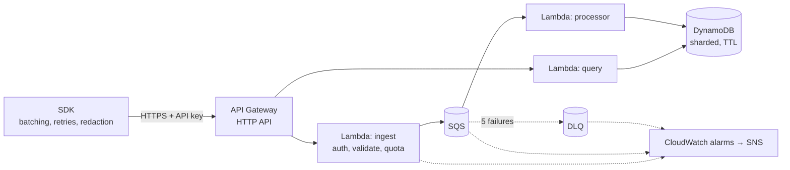

# Tracewise

LLM observability and evaluation on serverless AWS. Apps send every model call to Tracewise. It stores them per tenant, scores quality automatically, and alerts when quality, cost or attacks change.

- **[PR/FAQ](docs/PRFAQ.md):** the product, written working backwards.
- **[Design document](docs/design.md):** requirements, architecture, service trade-offs, failure modes, cost model, validation plan.
- **[Experiments](docs/experiments.md):** measurements from the deployed stack. The first one cut ingest-to-queryable latency from 6.3 s to 63 ms (p50).

> **Status:** Milestone 1 of 6 (the ingest pipeline, API keys and SDK) is built and tested. Analytics, evaluations, the dashboard and the load test are next. See [milestones](docs/design.md#9-milestones).

## Architecture (Milestone 1)



**Highlights:**
- **The request path only enqueues.** The ingest function authenticates, validates and sends to SQS, then returns `202`. Storage writes happen asynchronously, so bursts queue up instead of failing.
- **Idempotent end to end.** Event IDs are generated by the SDK, and the DynamoDB key is derived from them, so at-least-once delivery and client retries never create duplicates.
- **Write sharding.** Each tenant's daily partition is split ten ways by a hash of the event ID, so one busy tenant can't create a hot partition. Reads fan out across the shards in parallel.
- **Partial-batch failure handling.** The processor reports failures per message, retries DynamoDB's unprocessed items with backoff, and dead-letters after five attempts. An alarm fires on the first dead letter.
- **Tenant isolation.** The tenant comes from the hashed API key, never from the request. API keys are stored only as SHA-256 hashes.
- **Per-tenant quotas** are counted atomically in DynamoDB, so they hold across every concurrent Lambda.
- **Least-privilege IAM.** For example, the ingest function can't read or write traces at all, and a test enforces that.

## The SDK

```ts
import { Tracewise } from "@tracewise/sdk";

const tw = new Tracewise({ apiKey: process.env.TRACEWISE_KEY!, endpoint: process.env.TRACEWISE_URL! });

const reply = await tw.trace(
	{ model: "gpt-4.1", input: prompt, route: "support-bot", output: (r) => r.choices[0].message.content },
	() => openai.chat.completions.create({ model: "gpt-4.1", messages }),
);

await tw.shutdown(); // flush before the process exits
```

- **Batching:** sends up to 50 events, or every 2 s, whichever comes first.
- **Retries:** retries `429`, `5xx` and network errors with exponential backoff and full jitter.
- **Bounded memory:** the buffer has a cap, and the oldest events are dropped beyond it.
- **Never blocks or breaks your app:** errors go to an optional `onError` callback.
- **Redaction:** an optional `redact` hook runs before data leaves your process.

## Run it

Requirements: Node 22+, pnpm, AWS CLI v2, and AWS CDK.

```sh
pnpm install
pnpm test                 # 37 tests: logic, SDK, and CDK assertions on the synthesized stack
pnpm synth                # build the CloudFormation template locally, no AWS needed

aws sso login             # with a profile from `aws configure sso`
cdk bootstrap             # once per account and region
pnpm run deploy -c alarmEmail=you@example.com
pnpm tenant:create "Demo tenant"   # prints an API key once; save it with the URL in .env.local
node --env-file=.env.local --import tsx scripts/smoke.ts     # end-to-end checks
node --env-file=.env.local --import tsx scripts/latency.ts   # pipeline latency percentiles
```

```sh
curl -X POST "$API_URL/v1/traces" -H "authorization: Bearer $KEY" -H 'content-type: application/json' \
  -d '{"events":[{"event_id":"'$(uuidgen | tr A-Z a-z)'","ts":"'$(date -u +%FT%TZ)'","model":"demo","input":"hi","output":"hello","latency_ms":120}]}'
curl "$API_URL/v1/traces" -H "authorization: Bearer $KEY"
```

`cdk destroy` removes everything, including all data.

## Layout

```
infra/          CDK app and stack, plus assertion tests on the template
services/       Lambda handlers: ingest, processor, query, plus shared schema/keys/tenants
sdk/            @tracewise/sdk: batching, retrying, redacting client
scripts/        create-tenant
docs/           PR/FAQ and design document
```
