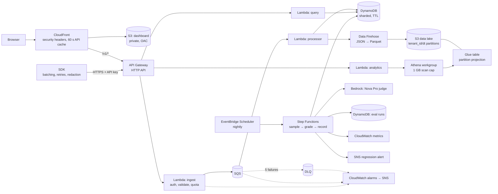

# Tracewise

LLM observability and evaluation on serverless AWS. Apps send every model call to Tracewise. It stores them per tenant, scores quality automatically, and alerts when quality, cost or attacks change.

**Live dashboard:** https://d67mankz12h3n.cloudfront.net (public demo data, read-only)

- **[PR/FAQ](docs/PRFAQ.md):** the product, written working backwards.
- **[Design document](docs/design.md):** requirements, architecture, service trade-offs, failure modes, cost model, validation plan.
- **[Experiments](docs/experiments.md):** measurements from the deployed stack. They cover cutting ingest-to-queryable latency from 6.3 s to 63 ms (p50), proving that Athena itself refuses queries that skip the tenant filter, and choosing an evaluation judge by calibrating four models against labelled answers. The chosen judge caught a simulated bad deploy (score 4.5 → 2.45).

> **Status:** Milestones 1–4 of 6 are live: the ingest pipeline and SDK, the S3/Athena data lake with an analytics API, nightly AI evaluations with regression alerts, and a public dashboard. The load test and write-up are next. See [milestones](docs/design.md#9-milestones).

## Architecture (Milestones 1–4)



**Highlights:**
- **The request path only enqueues.** The ingest function authenticates, validates and sends to SQS, then returns `202`. Storage writes happen asynchronously, so bursts queue up instead of failing.
- **Idempotent end to end.** Event IDs are generated by the SDK, and the DynamoDB key is derived from them, so at-least-once delivery and client retries never create duplicates.
- **Write sharding.** Each tenant's daily partition is split ten ways by a hash of the event ID, so one busy tenant can't create a hot partition. Reads fan out across the shards in parallel.
- **Partial-batch failure handling.** The processor reports failures per message, retries DynamoDB's unprocessed items with backoff, and dead-letters after five attempts. An alarm fires on the first dead letter.
- **Tenant isolation.** The tenant comes from the hashed API key, never from the request. API keys are stored only as SHA-256 hashes.
- **Per-tenant quotas** are counted atomically in DynamoDB, so they hold across every concurrent Lambda.
- **A data lake that enforces isolation.** Firehose converts events to Parquet and partitions them by tenant and day. The Glue table uses *injected* partition projection, so Athena rejects any query that doesn't name a tenant, and a tenant's query reads only that tenant's prefix. Proven in [experiment 2](docs/experiments.md#2-the-data-lake-tenant-isolation-and-what-a-query-actually-reads).
- **Cost guardrails on analytics.** The Athena workgroup enforces a 1 GB per-query scan cap that callers can't override. Repeated questions reuse cached results, and S3 lifecycle rules tier and expire data.
- **Nightly AI evaluations.** A Step Functions workflow samples each tenant's day, grades every sample with a Bedrock judge against the tenant's rubric, stores the run, publishes CloudWatch metrics, and alerts through SNS when quality drops 0.5+ below the 7-run baseline or any safety check fails. Throttled grades retry with backoff in the workflow. Ungradable traces are recorded as failures rather than failing the run. Only DynamoDB keys move between steps (the claim-check pattern), so the 256 KB state limit never matters.
- **A judge chosen by measurement and hardened against injection.** The judge was picked by calibrating four Bedrock models on 24 labelled answers, and it's prompted with a random boundary fence so a conversation can't instruct it to grade itself 5/5.
- **A public dashboard that's safe to publish.** Static files sit in a private S3 bucket that only CloudFront can read (origin access control). CloudFront also fronts the API on the same domain, so there's no CORS. It caches API reads for 60 s per key, so a busy page costs one Athena query, not hundreds. A strict Content Security Policy allows no third-party or inline scripts, and every API value is rendered as text, so customer-supplied trace content can't inject HTML. The page uses a **read-only** key scope: it can query the demo tenant but the ingest API rejects it.
- **Least-privilege IAM.** For example, the ingest function can't read or write traces at all, and a test enforces that.

## The SDK

```ts
import { Tracewise } from "@tracewise/sdk";

const tw = new Tracewise({ apiKey: process.env.TRACEWISE_KEY!, endpoint: process.env.TRACEWISE_URL! });

const reply = await tw.trace(
	{ model: "gpt-4.1", input: prompt, route: "support-bot", output: (r) => r.choices[0].message.content },
	() => openai.chat.completions.create({ model: "gpt-4.1", messages }),
);

await tw.shutdown(); // flush before the process exits
```

- **Batching:** sends up to 50 events, or every 2 s, whichever comes first.
- **Retries:** retries `429`, `5xx` and network errors with exponential backoff and full jitter.
- **Bounded memory:** the buffer has a cap, and the oldest events are dropped beyond it.
- **Never blocks or breaks your app:** errors go to an optional `onError` callback.
- **Redaction:** an optional `redact` hook runs before data leaves your process.

## Run it

Requirements: Node 22+, pnpm, AWS CLI v2, and AWS CDK.

```sh
pnpm install
pnpm test                 # 63 tests: logic, SDK, and CDK assertions on the synthesized stack
pnpm synth                # build the CloudFormation template locally, no AWS needed

aws sso login             # with a profile from `aws configure sso`
cdk bootstrap             # once per account and region
TRACEWISE_ALARM_EMAIL=you@example.com TRACEWISE_DASHBOARD_KEY=<read-only key> pnpm run deploy
pnpm tenant:create "Demo tenant"   # prints an API key once; save it with the URL in .env.local
pnpm exec tsx scripts/create-key.ts "Demo tenant" read   # a read-only key, e.g. for the dashboard
node --env-file=.env.local --import tsx scripts/smoke.ts     # end-to-end checks
node --env-file=.env.local --import tsx scripts/latency.ts   # pipeline latency percentiles
node --env-file=.env.local --import tsx scripts/seed.ts      # a week of demo traffic for analytics
pnpm exec tsx scripts/calibrate-judge.ts <bedrock-model-id>...   # compare judges against labels
pnpm exec tsx scripts/run-evals.ts [YYYY-MM-DD]                  # run the evaluation workflow now
```

```sh
curl -X POST "$API_URL/v1/traces" -H "authorization: Bearer $KEY" -H 'content-type: application/json' \
  -d '{"events":[{"event_id":"'$(uuidgen | tr A-Z a-z)'","ts":"'$(date -u +%FT%TZ)'","model":"demo","input":"hi","output":"hello","latency_ms":120}]}'
curl "$API_URL/v1/traces" -H "authorization: Bearer $KEY"
curl "$API_URL/v1/analytics/summary?days=7" -H "authorization: Bearer $KEY"   # cost, p50/p95, errors, blocks by route
curl "$API_URL/v1/evals" -H "authorization: Bearer $KEY"                        # recent evaluation runs
```

`cdk destroy` removes everything, including all data.

## Layout

```
infra/          CDK app and stack, plus assertion tests on the template
dashboard/      the dashboard: plain HTML, CSS and JS, no build step or dependencies
services/       Lambda handlers: ingest, processor, query, analytics, evals, plus shared schema/keys/tenants
eval/           labelled conversations for judge calibration
sdk/            @tracewise/sdk: batching, retrying, redacting client
scripts/        create-tenant
docs/           PR/FAQ and design document
```
