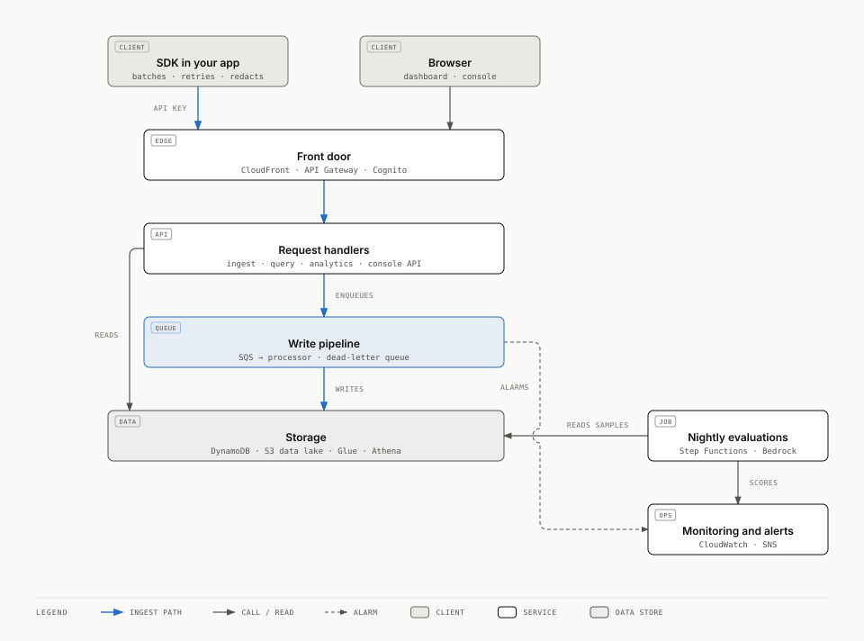
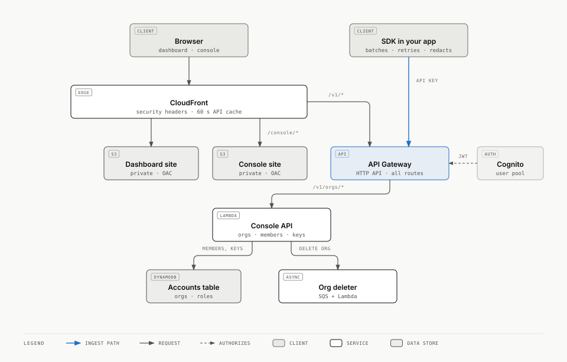
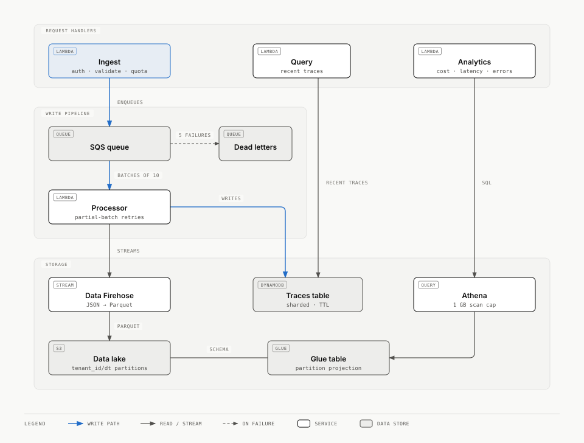
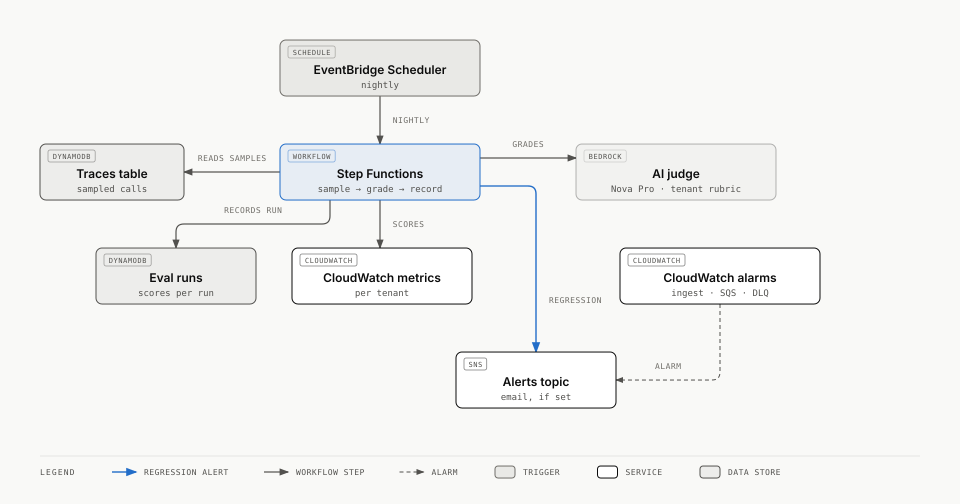

# Tracewise

LLM observability and evaluation on serverless AWS. Apps send every model call to Tracewise. It stores them per tenant, scores quality automatically, and alerts when quality, cost or attacks change.

**Live dashboard:** https://d67mankz12h3n.cloudfront.net (public demo data, read-only)

**Write-up:** [My load test proved my best optimization wrong, and that was the most useful thing it did](docs/blog-post.md)

- **[Sign up](#sign-up):** create an organisation, get a key and see your first trace in about 30 seconds.
- **[PR/FAQ](docs/PRFAQ.md):** the product, written working backwards.
- **[Design document](docs/design.md):** requirements, architecture, service trade-offs, failure modes, cost model, validation plan.
- **[Experiments](docs/experiments.md):** measurements from the deployed stack. They cover a load test that found two hidden account limits and still lost nothing, cutting ingest-to-queryable latency from 6.3 s to 63 ms (p50), proving that Athena itself refuses queries that skip the tenant filter, and choosing an evaluation judge by calibrating four models against labelled answers. The chosen judge caught a simulated bad deploy (score 4.5 → 2.45).

> **Status:** All 6 milestones are done: the ingest pipeline and SDK, the S3/Athena data lake with an analytics API, nightly AI evaluations with regression alerts, a public dashboard, a load test, and a [write-up](docs/blog-post.md). **Load-tested at 1,000 events/s sustained and a 5,000 events/s burst: 751,200 events accepted, 751,200 stored, zero lost.** See [milestones](docs/design.md#9-milestones).

## Architecture (Milestones 1–4, plus self-serve accounts)



The overview follows a trace from top to bottom. Each layer is drawn in full below.

**Front door and accounts**



**Ingest, storage and reads**



**Nightly evaluations and alerts**



Diagram sources are in [`docs/architecture/`](docs/architecture/): each `.svg` is exported from the `.html` beside it.


**Highlights:**
- **The request path only enqueues.** The ingest function authenticates, validates and sends to SQS, then returns `202`. Storage writes happen asynchronously, so bursts queue up instead of failing.
- **Idempotent end to end.** Event IDs are generated by the SDK, and the DynamoDB key is derived from them, so at-least-once delivery and client retries never create duplicates.
- **Write sharding.** Each tenant's daily partition is split ten ways by a hash of the event ID, so one busy tenant can't create a hot partition. Reads fan out across the shards in parallel.
- **Partial-batch failure handling.** The processor reports failures per message, retries DynamoDB's unprocessed items with backoff, and dead-letters after five attempts. An alarm fires on the first dead letter.
- **Tenant isolation.** The tenant comes from the hashed API key, never from the request. API keys are stored only as SHA-256 hashes.
- **Per-tenant quotas** are counted atomically in DynamoDB, so they hold across every concurrent Lambda.
- **A data lake that enforces isolation.** Firehose converts events to Parquet and partitions them by tenant and day. The Glue table uses *injected* partition projection, so Athena rejects any query that doesn't name a tenant, and a tenant's query reads only that tenant's prefix. Proven in [experiment 2](docs/experiments.md#2-the-data-lake-tenant-isolation-and-what-a-query-actually-reads).
- **Cost guardrails on analytics.** The Athena workgroup enforces a 1 GB per-query scan cap that callers can't override. Repeated questions reuse cached results, and S3 lifecycle rules tier and expire data.
- **Nightly AI evaluations.** A Step Functions workflow samples each tenant's day, grades every sample with a Bedrock judge against the tenant's rubric, stores the run, publishes CloudWatch metrics, and alerts through SNS when quality drops 0.5+ below the 7-run baseline or any safety check fails. Throttled grades retry with backoff in the workflow. Ungradable traces are recorded as failures rather than failing the run. Only DynamoDB keys move between steps (the claim-check pattern), so the 256 KB state limit never matters.
- **A judge chosen by measurement and hardened against injection.** The judge was picked by calibrating four Bedrock models on 24 labelled answers, and it's prompted with a random boundary fence so a conversation can't instruct it to grade itself 5/5.
- **A public dashboard that's safe to publish.** Static files sit in a private S3 bucket that only CloudFront can read (origin access control). CloudFront also fronts the API on the same domain, so there's no CORS. It caches API reads for 60 s per key, so a busy page costs one Athena query, not hundreds. A strict Content Security Policy allows no third-party or inline scripts, and every API value is rendered as text, so customer-supplied trace content can't inject HTML. The page uses a **read-only** key scope: it can query the demo tenant but the ingest API rejects it.
- **Self-serve accounts.** Anyone with a verified email signs up through Cognito, creates an organisation and gets a key. Orgs have owners and members, invites, revocable keys, an eval rubric and per-org limits, all managed in a plain-JS console or through a JWT-authorized API on the same domain. Membership and roles live in DynamoDB (`Accounts` table), not Cognito groups. Deleting an org queues a deleter that removes its keys, memberships, traces and lake partitions. Free-tier limits and three global caps bound what one person can spend. See the [spec](docs/superpowers/specs/2026-10-22-self-serve-accounts-design.md).
- **Paid plans.** Free, Team and Pro plans with Stripe Billing: Checkout to subscribe, a flat monthly price plus metered overage, and an hourly job that reports each paid org's events to Stripe. Ingest enforces the plan's allowance and an optional spend cap without calling Stripe. See [Plans and billing](#plans-and-billing) and the [spec](docs/superpowers/specs/2026-10-23-billing-and-plans-design.md).
- **Least-privilege IAM.** For example, the ingest function can't read or write traces at all, and a test enforces that.

## Sign up

Open the console at `<DashboardUrl>/console/index.html`, where `<DashboardUrl>` is the stack's `DashboardUrl` output (the live dashboard link above).

1. **Sign up** with an email and password on the hosted page, then enter the code Cognito emails you.
2. **Create an organisation.** Give it a name.
3. **Copy your API key.** It's shown once, with a curl quickstart already filled in with your endpoint.
4. **Send a trace** with the curl command or the [SDK](#the-sdk), and watch it appear under Traces.

Every organisation starts on the Free plan, which the console's Usage and Billing pages show against its limits. See [Plans and billing](#plans-and-billing) for all the plans.

Ingest answers `429` at a cap, with `x-tracewise-limit: minute`, `month` (Free's allowance is used up) or `spend_cap` (a paid org's own cap). The monthly ones set `retry-after` to the seconds until the period ends. Hitting the key, member or invite cap returns `409` with the limit's name.

An event's `ts` is set by the client. Events stamped further back than the org's hot retention (7, 30 or 90 days by plan, plus a day) or more than a day ahead go to the analytics lake only, not the hot store, so the Traces view and evaluations don't see them.

Three global caps protect the whole service: one person can own at most **3 organisations**, at most **100 organisations** can be created per UTC day, and the nightly evaluation makes at most **2,000 judge calls** for Free orgs, shared equally, plus at most **1,000** for paid, custom and legacy orgs together (scaled down in proportion when their allowances add up to more, until the eval-scaling work moves the run to a Distributed Map). A `GlobalCapHit` alarm tells the operator when the sign-up cap is reached. An operator can set one org's limits by hand with `set-limits` (see [Run it](#run-it)).

**Email limit.** Cognito's built-in email sender allows **50 emails a day** for the whole user pool, and verification and password-reset emails count against it. The console's app client is public, so anyone can call `SignUp` about 50 times in a day and use up the quota, and real users then get no verification or reset codes until it resets. So this is an abuse risk, not only a capacity limit. Before a public launch, send through Amazon SES (a verified domain and SES production access), or put a WAF rate limit on the user pool, or both. Invites aren't emailed: the owner copies a link.

**Deleting an organisation** removes its keys, members, invites, eval runs, DynamoDB traces and the `traces/` partitions in the lake, then leaves a tombstone profile. A final sweep 15 minutes later catches writes that were still in flight, including an eval run recorded while the deletion started. It deliberately leaves `errors/` (malformed records, 14-day lifecycle) and `athena-results/` (query output, 7-day lifecycle) to expire on their own.

**If a deletion gets stuck.** A step that fails 5 times goes to the deletion dead-letter queue and fires the `DeletionDeadLetters` alarm. The org stays `deleting`: it's hidden from the console and its keys no longer work, but some of its data is still there. Read the message on the dead-letter queue (it names the org and the phase), and the deleter's logs for the error, then fix the cause. Then move the message back to the deletion queue:

```sh
aws sqs list-queues --queue-name-prefix Tracewise-SelfServeDeletionDLQ             # the DLQ's URL (the queue's is the DeletionQueue output)
aws sqs get-queue-attributes --queue-url <url> --attribute-names QueueArn          # for each of the two
aws sqs start-message-move-task --source-arn <deletion DLQ ARN> --destination-arn <deletion queue ARN>
```

The deleter is idempotent and re-checks that the org is still `deleting` before every step, so a redriven message carries on where it stopped, and one for an org that is no longer deleting does nothing.

## Plans and billing

Plans are billed monthly in US dollars. The public pricing page is [`dashboard/pricing.html`](dashboard/pricing.html), served at `<DashboardUrl>/pricing.html`, and a unit test keeps it in line with the plan table in code (`services/billing/plans.ts`).

| | Free | Team | Pro | Enterprise |
|---|---|---|---|---|
| Price | $0 | $29/month | $199/month | Contact us |
| Included events per period | 50,000 (hard cap) | 500,000 | 5,000,000 | custom |
| Extra events | none | $5 per 100,000 | $3 per 100,000 | custom |
| Judge samples per night | 20 (shared free pool) | 100 | 500 | custom |
| Hot retention | 7 days | 30 days | 90 days | 30 days |
| Events per minute | 600 | 6,000 | 30,000 | custom |
| Members / keys / pending invites | 2 / 3 / 2 | 10 / 20 / 10 | 50 / 100 / 50 | custom |
| Analytics queries per day | 200 | 2,000 | 10,000 | custom |

- **Free is a hard cap.** After its 50,000 events in a UTC calendar month, ingest answers `429` until the next month. Team and Pro keep accepting events and bill the extra ones, unless the owner sets a spend cap in the console.
- **Plan changes happen in the console.** The owner subscribes through Stripe Checkout and switches between Team and Pro with the console's plan-change route (`POST /v1/orgs/{id}/billing/change`). The Stripe Customer Portal ("Manage billing") handles payment methods, invoices and cancellation, not plan switching. The Stripe webhook is the only thing that changes an org's plan.
- **Downgrades never delete data**, keys or members. They only block new ones above the new limits, and traces already stored keep the retention they were written with.
- **Enterprise ("Contact us") and custom orgs.** There is no self-serve Enterprise plan. An operator sets those orgs up by hand with `set-limits`: plan `custom`, 30-day retention, and no subscription. The "Contact us" text is plain text for now: a contact address is still to be decided and isn't in the product yet.
- **Past due** keeps the paid plan for 7 days, then the org gets Free limits. Its owner can still reach Manage billing to pay or cancel, and the console shows a payment-problem banner until that's done.
- **Paid plans are switched off by default.** Checkout and plan changes answer `403` until the stack is deployed with `--context billingCheckout=true` (see step 9 below). The Billing screen then hides the upgrade and switch buttons.
- **Deleting an organisation** is refused while it has a Stripe subscription that is active, trialing, past due, unpaid or incomplete: the owner cancels it in Manage billing first, because deleting the org doesn't stop Stripe charging.

How it works is in the [billing spec](docs/superpowers/specs/2026-10-23-billing-and-plans-design.md), including its "Changes during planning and implementation" section.

### Stripe setup

Do this in Stripe **test mode** first, in order. The values called "outputs" below are the `Tracewise` stack's outputs (`aws cloudformation describe-stacks --stack-name Tracewise --query "Stacks[0].Outputs"`). The secret is named by CDK, so always use the `StripeSecretArn` output, never a fixed name.

1. **Create the Stripe objects.** This makes the meter (`tracewise_events`), the Team and Pro products and prices, and the Customer Portal configuration, or confirms they exist. It is safe to rerun, prints object ids only, and refuses a live key without `--live`. It then checks Stripe Tax (step 2) and exits non-zero, saying what to configure, until Stripe Tax is active. Pass `--skip-tax-check` to create the objects first and set up tax afterwards.

   ```sh
   STRIPE_SECRET_KEY=sk_test_... pnpm exec tsx scripts/stripe-setup.ts
   ```

2. **Set up Stripe Tax, in test mode now and again in live mode before going live.** Checkout runs with automatic tax, and Stripe refuses every Checkout session (the console answers 500) until Stripe Tax is active in that mode. In the Stripe Dashboard open Settings > Tax and set the head office address and the default tax behaviour (whether prices include tax or have it added), then add a registration wherever you must collect tax. Rerun `stripe-setup` until it reports "Stripe Tax is active".

3. **Put the keys in the secret.** The stack creates it with placeholder values. Replace them with your test secret key and, for now, a placeholder webhook secret (step 4 gives you the real one):

   ```sh
   aws secretsmanager put-secret-value --secret-id <StripeSecretArn output> \
     --secret-string '{"secret_key":"sk_test_...","webhook_secret":"whsec_placeholder"}'
   ```

4. **Register the webhook.** In the Stripe Dashboard (test mode) add an endpoint at the `StripeWebhookUrl` output, listening to exactly these events: `checkout.session.completed`, `customer.subscription.created`, `customer.subscription.updated`, `customer.subscription.deleted`, `invoice.paid` and `invoice.payment_failed`. Copy the endpoint's signing secret (`whsec_...`) and put it into the secret from step 3 with the same `put-secret-value` command.

5. **No redeploy needed for new keys.** The billing functions and the console re-read the secret at most 5 minutes after it changes, and the webhook re-reads it straight away when a delivery fails the signature check, so a new `webhook_secret` works on Stripe's next delivery (Stripe retries failed ones). A webhook secret that still doesn't match raises the `BillingWebhookSignatureRejected` alarm (3 or more rejections in 15 minutes): check that `webhook_secret` is the endpoint's signing secret for the same mode as `secret_key`.

6. **Expect `BillingMeterStale` to fire.** The alarm goes off when the hourly meter hasn't reported a successful run for 3 hours, and it counts missing data as breaching, so it fires on a fresh deploy until the first hourly run succeeds. Wait for that run (or invoke the BillingMeter function once) and it clears.

7. **Run the smoke test.** It needs the stack deployed with the smoke client (see `smoke-selfserve` below), and is test mode only (live keys are refused). Your AWS credentials need `cloudformation:DescribeStacks` on the stack, Cognito admin on its user pool (`AdminCreateUser`, `AdminSetUserPassword`, `AdminInitiateAuth`, `AdminDeleteUser`), and read and write access to the Accounts table and read access to the Quotas table:

   ```sh
   STRIPE_SECRET_KEY=sk_test_... pnpm exec tsx scripts/smoke-billing.ts
   ```

   It creates a throwaway user and org, a Stripe test clock with a customer and a Team subscription, and checks that the webhook moved the org to Team, that Stripe's meter summary for the customer matches what was ingested, that the invoice after advancing the clock has the $29 base line and the metered line, and that cancelling returns the org to Free. It cleans up afterwards, even on failure: it deletes the test clock (and so its customer and subscription) and the Cognito user, and requests the org's deletion, which the deleter then finishes in the background. If a cleanup step fails it says what to remove by hand and the run fails. `--overage` also ingests 500,001 events to price a real overage line: it is paced by Team's 6,000 events a minute limit, so it takes about 90 minutes and costs about $1.50 of AWS. To click through Checkout and the Customer Portal by hand in the console, deploy with `--context billingCheckout=true` on the test stack first.

8. **Before going live (the owner's side):**
   - Check in test mode what Stripe answers for a **duplicate meter-event identifier**. The meter treats a recognised duplicate as success (it retries an unconfirmed send with the same identifier), so the error's shape has to match what `isDuplicateIdentifier` in `services/billing/meter.ts` recognises. Send the same event twice with the Stripe CLI or API and confirm.
   - Activate the Stripe account.
   - Set up Stripe Tax in live mode (step 2) and register for tax where Stripe Tax shows thresholds.
   - Publish terms of service, privacy and refund policy pages, and link them from Checkout and the console.
   - Preferably move to a real domain.
   - Then put the **live** keys in the secret, rerun `STRIPE_SECRET_KEY=sk_live_... pnpm exec tsx scripts/stripe-setup.ts --live`, create the live webhook endpoint at the same URL and update `webhook_secret`. The functions pick the keys up within 5 minutes (step 5). Delete the test-mode endpoint, or leave it: the webhook answers events from the other mode with a 200 and ignores them.

9. **Test-to-live reset, then turn on paid plans.** Once the secret holds the live key, every BILLING and `STRIPE#` row written in test mode is ignored automatically: Checkout makes the org a new live customer, the meter skips it, the webhook ignores test events and the Billing screen shows no subscription. What isn't automatic is the plan an org was upgraded to in test mode, so move those orgs back to Free. The script never calls Stripe (the key only proves live mode), prints what it would change, and writes only with `--apply`:

   ```sh
   STRIPE_SECRET_KEY=sk_live_... pnpm exec tsx scripts/reset-test-billing.ts           # dry run
   STRIPE_SECRET_KEY=sk_live_... pnpm exec tsx scripts/reset-test-billing.ts --apply   # move them to Free
   ```

   It moves every active Team or Pro org that no live subscription holds open to Free, the way a cancellation would; free, custom and non-active orgs are left alone. Then redeploy with `--context billingCheckout=true` so owners can buy plans, and keep passing it on every later deploy: a deploy without it switches paid plans off again (existing subscriptions are unaffected).

**Runbook notes.**

- **A meter event left `pending`** on a BILLING row is re-sent by the next hourly run with the same identifier. Stripe deduplicates meter-event identifiers for at least 24 hours, so a re-send is safe within that window; a `pending` older than a few hours means sends keep failing (check the BillingMeter logs and the `BillingMeterErrors` alarm) and should be investigated before the 24 hours run out, or the event could be billed twice.
- **Cancelling a subscription by hand** (Stripe Dashboard or API) should use `invoice_now: true`, so the usage of the unfinished period is invoiced now rather than lost. The meter's final flush still reports it; `invoice_now` makes Stripe bill it.
- **Meter errors Stripe raises asynchronously** (for example a meter event for a customer it can't find) arrive as `v1.billing.meter.error_report_triggered` events. Subscribing the webhook endpoint to them, and alarming on them, is a follow-up; until then check the meter's error reports in the Stripe Dashboard after a deploy or a key change.

## The SDK

```ts
import { Tracewise } from "@tracewise/sdk";

const tw = new Tracewise({ apiKey: process.env.TRACEWISE_KEY!, endpoint: process.env.TRACEWISE_URL! });

const reply = await tw.trace(
	{ model: "gpt-4.1", input: prompt, route: "support-bot", output: (r) => r.choices[0].message.content },
	() => openai.chat.completions.create({ model: "gpt-4.1", messages }),
);

await tw.shutdown(); // flush before the process exits
```

- **Batching:** sends up to 50 events, or every 2 s, whichever comes first.
- **Retries:** retries `429`, `5xx` and network errors with exponential backoff and full jitter.
- **Bounded memory:** the buffer has a cap, and the oldest events are dropped beyond it.
- **Never blocks or breaks your app:** errors go to an optional `onError` callback.
- **Redaction:** an optional `redact` hook runs before data leaves your process.

## Run it

Requirements: Node 22+, pnpm, AWS CLI v2, and AWS CDK.

```sh
pnpm install
pnpm test                 # the tests: logic, SDK, console API, and CDK assertions on the synthesized stack
pnpm synth                # build the CloudFormation template locally, no AWS needed

aws sso login             # with a profile from `aws configure sso`
cdk bootstrap             # once per account and region
TRACEWISE_ALARM_EMAIL=you@example.com TRACEWISE_DASHBOARD_KEY=<read-only key> pnpm run deploy
pnpm tenant:create "Demo tenant"   # prints an API key once; save it with the URL in .env.local
pnpm exec tsx scripts/create-key.ts "Demo tenant" read   # a read-only key, e.g. for the dashboard
node --env-file=.env.local --import tsx scripts/smoke.ts     # end-to-end checks
node --env-file=.env.local --import tsx scripts/latency.ts   # pipeline latency percentiles
node --env-file=.env.local --import tsx scripts/seed.ts      # a week of demo traffic for analytics
node --env-file=.env.local --import tsx scripts/loadtest.ts "1000x300,5000x60"   # open-loop load test
pnpm exec tsx scripts/loadtest-metrics.ts <startISO> <endISO>                  # server-side view from CloudWatch
pnpm exec tsx scripts/calibrate-judge.ts <bedrock-model-id>...   # compare judges against labels
pnpm exec tsx scripts/run-evals.ts [YYYY-MM-DD]                  # run the evaluation workflow now
```

**Self-serve operator commands.** Run them in this order on an existing deployment. Set `TRACEWISE_ALARM_EMAIL` and `TRACEWISE_DASHBOARD_KEY` on every redeploy, this one included: a deploy without them publishes the demo with an empty key and drops the alarm email subscription.

```sh
TRACEWISE_ALARM_EMAIL=you@example.com TRACEWISE_DASHBOARD_KEY=<read-only key> pnpm run deploy --context smokeClient=true   # also adds the password-auth app client the smoke test needs
pnpm exec tsx scripts/migrate-accounts.ts [--owner you@example.com]   # turn existing tenants into orgs
pnpm exec tsx scripts/apply-plan-limits.ts                # move existing free orgs to the new Free limits and 7-day retention
pnpm exec tsx scripts/smoke-selfserve.ts                  # sign-up to deletion, end to end (about 20 minutes, up to 30, mostly waiting for the delayed sweep)
pnpm exec tsx scripts/set-limits.ts "<org name or id>" monthly_events=200000 max_members=10   # custom limits for one org
STRIPE_SECRET_KEY=sk_live_... pnpm exec tsx scripts/reset-test-billing.ts [--apply]   # once, after the switch to live Stripe keys
```

- **`migrate-accounts`** creates an org for each existing tenant, with its current rate as the per-minute limit and no monthly cap, so the public demo and load tests keep working. Running it again changes nothing already migrated. With `--owner`, the Cognito user with that email (they must have signed up first) becomes owner of every active org that has no owner yet, not only the ones this run creates. Keys of orgs that are deleting, deleted or suspended are retired as revoked, so unsuspending an org later doesn't restore them. Create new keys instead.
- **`apply-plan-limits`** moves every active `free` org to the Free plan's current limits (a monthly cap, 2 members, 3 keys, 2 pending invites) and sets 7-day retention for the traces it writes from then on. It leaves `custom`, paid and non-active orgs alone, writes each change conditionally on the org still being active and free, and prints counts. Running it again changes nothing already current. New Free orgs get the new limits at sign-up, so this only matters for orgs created before billing. Run it once the billing deploy is live, after `migrate-accounts`.
- **`smoke-selfserve`** creates two throwaway Cognito users and an org, ingests, checks that the key's `last_used_at` was stamped, queries, invites, checks permissions, revokes the key, then deletes the org. It waits (up to 25 minutes) for the deleter to tombstone the org's profile, then checks that the org's lake prefix and today's trace partitions are empty. It deletes the users afterwards, even on failure. It needs your operator credentials, including `s3:ListBucket` on the lake and read access to the Accounts and Traces tables. It creates one real org, so it counts toward the daily sign-up cap.
- **`set-limits`** takes `key=value` pairs for any of the limits above and marks the org's plan `custom`, with 30-day retention (unless it was already custom, in which case its retention is left as set). Unnamed limits keep their value. `monthly_events=null` removes the monthly cap. It also drops any Stripe period from the profile, so the org counts usage by calendar month. A custom org is never moved by the Stripe webhook, so `set-limits` refuses an org whose Stripe subscription is still active, trialing, past due, unpaid or incomplete: cancel the Stripe subscription first.
- **`reset-test-billing`** is described in [Stripe setup](#stripe-setup), step 9.
- **`smoke-billing`** is described in [Stripe setup](#stripe-setup).

```sh
curl -X POST "$API_URL/v1/traces" -H "authorization: Bearer $KEY" -H 'content-type: application/json' \
  -d '{"events":[{"event_id":"'$(uuidgen | tr A-Z a-z)'","ts":"'$(date -u +%FT%TZ)'","model":"demo","input":"hi","output":"hello","latency_ms":120}]}'
curl "$API_URL/v1/traces" -H "authorization: Bearer $KEY"
curl "$API_URL/v1/analytics/summary?days=7" -H "authorization: Bearer $KEY"   # cost, p50/p95, errors, blocks by route
curl "$API_URL/v1/evals" -H "authorization: Bearer $KEY"                        # recent evaluation runs
```

`cdk destroy` removes everything, including all data.

## Layout

```
infra/          CDK app and stack, plus assertion tests on the template
dashboard/      the public demo dashboard, and console/ for sign-up and org management: plain HTML, CSS and JS, no build step or dependencies
services/       Lambda handlers: ingest, processor, query, analytics, evals, console (accounts API), deleter (org deletion), billing (Stripe webhook and hourly meter), plus shared schema/keys/tenants/accounts
eval/           labelled conversations for judge calibration
sdk/            @tracewise/sdk: batching, retrying, redacting client
scripts/        operator scripts: create-tenant, create-key, migrate-accounts, apply-plan-limits, set-limits, stripe-setup, smoke tests (including smoke-billing), load test, evals
docs/           PR/FAQ, design document, and the self-serve accounts and billing specs and plans
```
