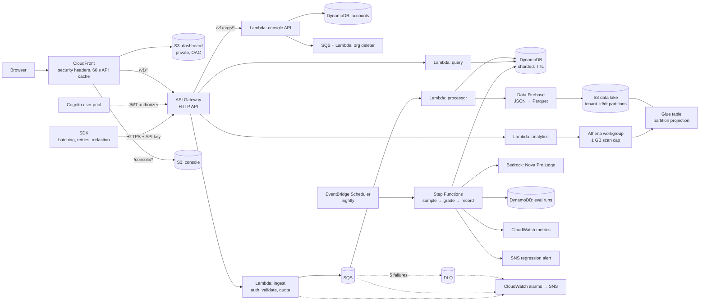

# Tracewise

LLM observability and evaluation on serverless AWS. Apps send every model call to Tracewise. It stores them per tenant, scores quality automatically, and alerts when quality, cost or attacks change.

**Live dashboard:** https://d67mankz12h3n.cloudfront.net (public demo data, read-only)

**Write-up:** [My load test proved my best optimization wrong, and that was the most useful thing it did](docs/blog-post.md)

- **[Sign up](#sign-up):** create an organisation, get a key and see your first trace in about 30 seconds.
- **[PR/FAQ](docs/PRFAQ.md):** the product, written working backwards.
- **[Design document](docs/design.md):** requirements, architecture, service trade-offs, failure modes, cost model, validation plan.
- **[Experiments](docs/experiments.md):** measurements from the deployed stack. They cover a load test that found two hidden account limits and still lost nothing, cutting ingest-to-queryable latency from 6.3 s to 63 ms (p50), proving that Athena itself refuses queries that skip the tenant filter, and choosing an evaluation judge by calibrating four models against labelled answers. The chosen judge caught a simulated bad deploy (score 4.5 → 2.45).

> **Status:** All 6 milestones are done: the ingest pipeline and SDK, the S3/Athena data lake with an analytics API, nightly AI evaluations with regression alerts, a public dashboard, a load test, and a [write-up](docs/blog-post.md). **Load-tested at 1,000 events/s sustained and a 5,000 events/s burst: 751,200 events accepted, 751,200 stored, zero lost.** See [milestones](docs/design.md#9-milestones).

## Architecture (Milestones 1–4, plus self-serve accounts)



**Highlights:**
- **The request path only enqueues.** The ingest function authenticates, validates and sends to SQS, then returns `202`. Storage writes happen asynchronously, so bursts queue up instead of failing.
- **Idempotent end to end.** Event IDs are generated by the SDK, and the DynamoDB key is derived from them, so at-least-once delivery and client retries never create duplicates.
- **Write sharding.** Each tenant's daily partition is split ten ways by a hash of the event ID, so one busy tenant can't create a hot partition. Reads fan out across the shards in parallel.
- **Partial-batch failure handling.** The processor reports failures per message, retries DynamoDB's unprocessed items with backoff, and dead-letters after five attempts. An alarm fires on the first dead letter.
- **Tenant isolation.** The tenant comes from the hashed API key, never from the request. API keys are stored only as SHA-256 hashes.
- **Per-tenant quotas** are counted atomically in DynamoDB, so they hold across every concurrent Lambda.
- **A data lake that enforces isolation.** Firehose converts events to Parquet and partitions them by tenant and day. The Glue table uses *injected* partition projection, so Athena rejects any query that doesn't name a tenant, and a tenant's query reads only that tenant's prefix. Proven in [experiment 2](docs/experiments.md#2-the-data-lake-tenant-isolation-and-what-a-query-actually-reads).
- **Cost guardrails on analytics.** The Athena workgroup enforces a 1 GB per-query scan cap that callers can't override. Repeated questions reuse cached results, and S3 lifecycle rules tier and expire data.
- **Nightly AI evaluations.** A Step Functions workflow samples each tenant's day, grades every sample with a Bedrock judge against the tenant's rubric, stores the run, publishes CloudWatch metrics, and alerts through SNS when quality drops 0.5+ below the 7-run baseline or any safety check fails. Throttled grades retry with backoff in the workflow. Ungradable traces are recorded as failures rather than failing the run. Only DynamoDB keys move between steps (the claim-check pattern), so the 256 KB state limit never matters.
- **A judge chosen by measurement and hardened against injection.** The judge was picked by calibrating four Bedrock models on 24 labelled answers, and it's prompted with a random boundary fence so a conversation can't instruct it to grade itself 5/5.
- **A public dashboard that's safe to publish.** Static files sit in a private S3 bucket that only CloudFront can read (origin access control). CloudFront also fronts the API on the same domain, so there's no CORS. It caches API reads for 60 s per key, so a busy page costs one Athena query, not hundreds. A strict Content Security Policy allows no third-party or inline scripts, and every API value is rendered as text, so customer-supplied trace content can't inject HTML. The page uses a **read-only** key scope: it can query the demo tenant but the ingest API rejects it.
- **Self-serve accounts.** Anyone with a verified email signs up through Cognito, creates an organisation and gets a key. Orgs have owners and members, invites, revocable keys, an eval rubric and per-org limits, all managed in a plain-JS console or through a JWT-authorized API on the same domain. Membership and roles live in DynamoDB (`Accounts` table), not Cognito groups. Deleting an org queues a deleter that removes its keys, memberships, traces and lake partitions. Free-tier limits and three global caps bound what one person can spend. See the [spec](docs/superpowers/specs/2026-10-22-self-serve-accounts-design.md).
- **Least-privilege IAM.** For example, the ingest function can't read or write traces at all, and a test enforces that.

## Sign up

Open the console at `<DashboardUrl>/console/index.html`, where `<DashboardUrl>` is the stack's `DashboardUrl` output (the live dashboard link above).

1. **Sign up** with an email and password on the hosted page, then enter the code Cognito emails you.
2. **Create an organisation.** Give it a name.
3. **Copy your API key.** It's shown once, with a curl quickstart already filled in with your endpoint.
4. **Send a trace** with the curl command or the [SDK](#the-sdk), and watch it appear under Traces.

Each organisation gets free limits, which the console's Usage page shows:

| Limit | Free |
|---|---|
| Events per minute | 600 |
| Events per day | 50,000 |
| Eval samples per night | 20 |
| Analytics queries per day | 200 |
| API keys | 10 |
| Members | 5 |
| Pending invites | 10 |

Ingest answers `429` at a cap, with `x-tracewise-limit: minute` or `day`. The daily one sets `retry-after` to the seconds until UTC midnight. Hitting the key, member or invite cap returns `409` with the limit's name.

An event's `ts` is set by the client. Events stamped more than 31 days ago or more than a day ahead go to the analytics lake only, not the 30-day hot store, so the Traces view and evaluations don't see them.

Three global caps protect the whole service: one person can own at most **3 organisations**, at most **100 organisations** can be created per UTC day, and the nightly evaluation makes at most **2,000 judge calls** in total. A `GlobalCapHit` alarm tells the operator when the sign-up cap is reached. An operator can raise one org's limits with `set-limits` (see [Run it](#run-it)).

**Email limit.** Cognito's built-in email sender allows **50 emails a day** for the whole user pool, and verification and password-reset emails count against it. The console's app client is public, so anyone can call `SignUp` about 50 times in a day and use up the quota, and real users then get no verification or reset codes until it resets. So this is an abuse risk, not only a capacity limit. Before a public launch, send through Amazon SES (a verified domain and SES production access), or put a WAF rate limit on the user pool, or both. Invites aren't emailed: the owner copies a link.

**Deleting an organisation** removes its keys, members, invites, eval runs, DynamoDB traces and the `traces/` partitions in the lake, then leaves a tombstone profile. A final sweep 15 minutes later catches writes that were still in flight, including an eval run recorded while the deletion started. It deliberately leaves `errors/` (malformed records, 14-day lifecycle) and `athena-results/` (query output, 7-day lifecycle) to expire on their own.

**If a deletion gets stuck.** A step that fails 5 times goes to the deletion dead-letter queue and fires the `DeletionDeadLetters` alarm. The org stays `deleting`: it's hidden from the console and its keys no longer work, but some of its data is still there. Read the message on the dead-letter queue (it names the org and the phase), and the deleter's logs for the error, then fix the cause. Then move the message back to the deletion queue:

```sh
aws sqs list-queues --queue-name-prefix Tracewise-SelfServeDeletionDLQ             # the DLQ's URL (the queue's is the DeletionQueue output)
aws sqs get-queue-attributes --queue-url <url> --attribute-names QueueArn          # for each of the two
aws sqs start-message-move-task --source-arn <deletion DLQ ARN> --destination-arn <deletion queue ARN>
```

The deleter is idempotent and re-checks that the org is still `deleting` before every step, so a redriven message carries on where it stopped, and one for an org that is no longer deleting does nothing.

## The SDK

```ts
import { Tracewise } from "@tracewise/sdk";

const tw = new Tracewise({ apiKey: process.env.TRACEWISE_KEY!, endpoint: process.env.TRACEWISE_URL! });

const reply = await tw.trace(
	{ model: "gpt-4.1", input: prompt, route: "support-bot", output: (r) => r.choices[0].message.content },
	() => openai.chat.completions.create({ model: "gpt-4.1", messages }),
);

await tw.shutdown(); // flush before the process exits
```

- **Batching:** sends up to 50 events, or every 2 s, whichever comes first.
- **Retries:** retries `429`, `5xx` and network errors with exponential backoff and full jitter.
- **Bounded memory:** the buffer has a cap, and the oldest events are dropped beyond it.
- **Never blocks or breaks your app:** errors go to an optional `onError` callback.
- **Redaction:** an optional `redact` hook runs before data leaves your process.

## Run it

Requirements: Node 22+, pnpm, AWS CLI v2, and AWS CDK.

```sh
pnpm install
pnpm test                 # 333 tests: logic, SDK, console API, and CDK assertions on the synthesized stack
pnpm synth                # build the CloudFormation template locally, no AWS needed

aws sso login             # with a profile from `aws configure sso`
cdk bootstrap             # once per account and region
TRACEWISE_ALARM_EMAIL=you@example.com TRACEWISE_DASHBOARD_KEY=<read-only key> pnpm run deploy
pnpm tenant:create "Demo tenant"   # prints an API key once; save it with the URL in .env.local
pnpm exec tsx scripts/create-key.ts "Demo tenant" read   # a read-only key, e.g. for the dashboard
node --env-file=.env.local --import tsx scripts/smoke.ts     # end-to-end checks
node --env-file=.env.local --import tsx scripts/latency.ts   # pipeline latency percentiles
node --env-file=.env.local --import tsx scripts/seed.ts      # a week of demo traffic for analytics
node --env-file=.env.local --import tsx scripts/loadtest.ts "1000x300,5000x60"   # open-loop load test
pnpm exec tsx scripts/loadtest-metrics.ts <startISO> <endISO>                  # server-side view from CloudWatch
pnpm exec tsx scripts/calibrate-judge.ts <bedrock-model-id>...   # compare judges against labels
pnpm exec tsx scripts/run-evals.ts [YYYY-MM-DD]                  # run the evaluation workflow now
```

**Self-serve operator commands.** Run them in this order on an existing deployment. Set `TRACEWISE_ALARM_EMAIL` and `TRACEWISE_DASHBOARD_KEY` on every redeploy, this one included: a deploy without them publishes the demo with an empty key and drops the alarm email subscription.

```sh
TRACEWISE_ALARM_EMAIL=you@example.com TRACEWISE_DASHBOARD_KEY=<read-only key> pnpm run deploy --context smokeClient=true   # also adds the password-auth app client the smoke test needs
pnpm exec tsx scripts/migrate-accounts.ts [--owner you@example.com]   # turn existing tenants into orgs
pnpm exec tsx scripts/smoke-selfserve.ts                  # sign-up to deletion, end to end (about 20 minutes, up to 30, mostly waiting for the delayed sweep)
pnpm exec tsx scripts/set-limits.ts "<org name or id>" monthly_events=200000 max_members=10   # custom limits for one org
```

- **`migrate-accounts`** creates an org for each existing tenant, with its current rate as the per-minute limit and no monthly cap, so the public demo and load tests keep working. Running it again changes nothing already migrated. With `--owner`, the Cognito user with that email (they must have signed up first) becomes owner of every active org that has no owner yet, not only the ones this run creates. Keys of orgs that are deleting, deleted or suspended are retired as revoked, so unsuspending an org later doesn't restore them. Create new keys instead.
- **`smoke-selfserve`** creates two throwaway Cognito users and an org, ingests, checks that the key's `last_used_at` was stamped, queries, invites, checks permissions, revokes the key, then deletes the org. It waits (up to 25 minutes) for the deleter to tombstone the org's profile, then checks that the org's lake prefix and today's trace partitions are empty. It deletes the users afterwards, even on failure. It needs your operator credentials, including `s3:ListBucket` on the lake and read access to the Accounts and Traces tables. It creates one real org, so it counts toward the daily sign-up cap.
- **`set-limits`** takes `key=value` pairs for any of the limits above and marks the org's plan `custom`. Unnamed limits keep their value. `monthly_events=null` removes the monthly cap.

```sh
curl -X POST "$API_URL/v1/traces" -H "authorization: Bearer $KEY" -H 'content-type: application/json' \
  -d '{"events":[{"event_id":"'$(uuidgen | tr A-Z a-z)'","ts":"'$(date -u +%FT%TZ)'","model":"demo","input":"hi","output":"hello","latency_ms":120}]}'
curl "$API_URL/v1/traces" -H "authorization: Bearer $KEY"
curl "$API_URL/v1/analytics/summary?days=7" -H "authorization: Bearer $KEY"   # cost, p50/p95, errors, blocks by route
curl "$API_URL/v1/evals" -H "authorization: Bearer $KEY"                        # recent evaluation runs
```

`cdk destroy` removes everything, including all data.

## Layout

```
infra/          CDK app and stack, plus assertion tests on the template
dashboard/      the public demo dashboard, and console/ for sign-up and org management: plain HTML, CSS and JS, no build step or dependencies
services/       Lambda handlers: ingest, processor, query, analytics, evals, console (accounts API), deleter (org deletion), plus shared schema/keys/tenants/accounts
eval/           labelled conversations for judge calibration
sdk/            @tracewise/sdk: batching, retrying, redacting client
scripts/        operator scripts: create-tenant, create-key, migrate-accounts, set-limits, smoke tests, load test, evals
docs/           PR/FAQ, design document, and the self-serve accounts spec and plan
```
