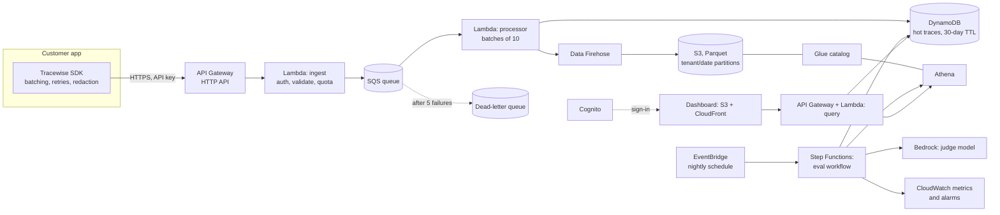

# Tracewise: design document

**Status:** Draft v1 · **Author:** [Your name] · **Related:** [PR/FAQ](PRFAQ.md)

## 1. Goals and non-goals

**Goals**
- Ingest LLM trace events from customer apps reliably, without adding latency to their requests.
- Sustain bursty write traffic and publish measured throughput and p99 latency.
- Keep each tenant's data isolated, with per-tenant quotas.
- Run scheduled evaluations (LLM-as-judge and deterministic checks) and alert on regressions.
- Query recent traces quickly, and run historical analytics cheaply.
- Deploy everything as code, in one command, at near-zero idle cost.

**Non-goals (v1):** billing, SSO, real-time streaming UI, self-hosting, prompt management.

## 2. Requirements and assumptions

| | Target for v1 |
|---|---|
| Sustained ingest | 1,000 events/s; the design scales to 10k+ by raising limits, without re-architecture (**measured: 999/s, zero backlog**) |
| Burst | 5× sustained for 60 s without dropping events (**measured: 0 lost; 90% accepted first time at a 10-execution Lambda limit, rest retried by the SDK**; see [experiment 4](experiments.md#4-load-test-1000-events-s-sustained-5-burst-zero-loss)) |
| Ingest API latency | p99 < 150 ms (the API only validates and enqueues) |
| Event size | ≤ 32 KB after SDK truncation; typical 2–4 KB |
| Durability | No acknowledged event lost |
| Freshness | Ingest to queryable: p50 < 5 s, p99 < 30 s ([measured: p50 63 ms](experiments.md)) |
| Recent-trace lookup | < 200 ms for a tenant's last 24 h |
| Analytics | Minutes-old data is fine; cost matters more than speed |
| Retention | Hot: 30 days. Cold: 1 year, configurable per tenant |
| Idle cost | Effectively $0 aside from stored data |

## 3. Architecture

### Request path: ingest
1. The SDK batches events in memory (up to 50 events or 2 s) and POSTs them to `/v1/traces` with the tenant's API key. On failure it retries with exponential backoff and jitter, then drops the oldest events once a bounded buffer fills. Customer requests are never blocked.
2. **API Gateway (HTTP API)** terminates TLS and applies a coarse per-key throttle.
3. **The ingest Lambda** hashes the API key and looks up the tenant (cached in memory for 60 s). It validates the schema, checks the tenant's quota, stamps `tenant_id`, `received_at` and an idempotency key, and calls `SendMessageBatch`. It returns `202` once SQS has accepted the batch, so the event is durable.
4. **SQS** absorbs bursts. **The processor Lambda** reads batches of up to 10 with no batching window, a setting chosen by measurement (see [experiments](experiments.md)), and writes to DynamoDB with `BatchWriteItem` and to Firehose with `PutRecordBatch`. It reports partial batch failures so only failed messages are retried. Five failures move a message to the **dead-letter queue**, and a CloudWatch alarm fires.

### Storage
- **DynamoDB (hot path):** table `traces`. Partition key is `tenant_id#yyyy-mm-dd#shard` and sort key is `ts#event_id`, so recent traces are a single `Query`. A TTL attribute expires items after 30 days. Using `shard` (0–9) as a suffix keeps a busy tenant from overloading one partition; reads fan out across the shards in parallel.
- **S3 and Athena (analytics):** Firehose buffers and converts records to Parquet, partitioned by `tenant_id/dt=…`. Athena queries that data through a Glue table with partition projection, so no crawlers are needed. S3 lifecycle rules move old data to cheaper tiers and expire it per retention policy.

### Evaluation workflow
**EventBridge Scheduler** starts a **Step Functions** state machine nightly:
1. Athena samples N traces per tenant from the last day, stratified by route or feature.
2. A Map state runs the evaluators in parallel with bounded concurrency. Each is either a deterministic check in a Lambda, or an **LLM judge on Bedrock** with the tenant's rubric.
3. Scores are written to DynamoDB, and aggregates are published as CloudWatch custom metrics per tenant and evaluator.
4. CloudWatch alarms on a drop against a 7-day baseline notify through SNS, with links to the worst-scoring traces.

### Security
- Tenant API keys are random 256-bit values shown once and stored as SHA-256 hashes.
- **IAM is least-privilege per function.** For example, the ingest function can only `sqs:SendMessage` to one queue.
- **Data is encrypted at rest** (SSE for DynamoDB, S3 and SQS) and in transit (TLS).
- **Tenant isolation:** every query path is keyed by the authenticated `tenant_id` and never by a client-supplied one.
- **Dashboard sign-in** uses Cognito user pools. Query APIs use a JWT authorizer.
- **Redaction** happens in the SDK, so sensitive fields never leave the customer's environment.

## 4. Key decisions and alternatives

| Decision | Chosen | Alternatives considered | Why |
|---|---|---|---|
| Ingest buffer | **SQS standard** | Kinesis Data Streams, MSK (Kafka) | No ordering need across events, per-message retries and DLQ built in, true pay-per-request, zero idle cost. Kinesis gives ordering and replay but bills per shard-hour even when idle. I'd move to Kinesis on-demand if replay or ordered per-tenant consumers became requirements. |
| Ingest compute | **Lambda** | ECS Fargate, App Runner | Spiky load, no idle cost, scales per request. Fargate wins at constant high throughput, where per-invocation cost overtakes per-hour cost. That crossover is in the cost model (§6). |
| API front door | **API Gateway HTTP API** | REST API, ALB | Cheaper and lower latency than the REST API. Usage plans (a REST API feature) are replaced by our own quota check, which is tenant-aware. |
| Hot store | **DynamoDB on-demand** | Aurora Serverless, OpenSearch | The access pattern is key-value by tenant and time, with predictable single-digit-ms reads and TTL built in. OpenSearch would add full-text search but runs always-on. |
| Analytics | **S3 Parquet + Athena** | Redshift Serverless, OpenSearch | Cheapest at rest, and pay-per-query suits nightly batch. Columnar Parquet and partition projection keep scans small. |
| Trigger batching | **Batch 10, no window** | Batch 100 with a 2 s window | Measured p50 63 ms vs. 6.3 s ([experiments](experiments.md)). Costs more Lambda requests at high volume (~$52 vs. ~$5/month at 1,000 events/s), which is configurable per deployment. |
| Orchestration | **Step Functions** | A long-running Lambda, AWS Batch | Retries, timeouts, parallel Map and visual run history without custom code. |
| Judge model | **Bedrock** | Calling a provider API directly | IAM-authenticated with no external keys, data stays in the account, and models are swappable. |
| IaC | **AWS CDK (TypeScript)** | Terraform, SAM | Typed, composable constructs, and same-language tests for the infrastructure. |

## 5. Scaling and failure modes

| Scenario | Behaviour |
|---|---|
| 5× traffic burst | API Gateway and Lambda scale out, and SQS queues the excess. Processor concurrency is capped so DynamoDB and Firehose aren't overwhelmed, and queue depth absorbs the difference. |
| A downstream write fails | Partial-batch failure reporting retries only failed messages. After 5 attempts, the DLQ alarm fires. Idempotency keys make retries safe (`PutItem` with the same keys). |
| Duplicate delivery (SQS is at-least-once) | Deduplicated by `event_id` in DynamoDB, and tolerated in analytics, where counts use `approx_distinct(event_id)` when exactness matters. |
| One tenant floods the system | A per-tenant quota in the ingest Lambda returns `429`. Write sharding keeps their partition from going hot. A per-key throttle at API Gateway is the backstop. |
| Bedrock throttles the eval run | Step Functions retries with backoff, and Map concurrency is bounded. The run completes late rather than failing. |
| A region outage | Out of scope for v1. The documented path is DynamoDB global tables, S3 cross-region replication, and a Route 53 failover record for the ingest endpoint. |

**Lambda concurrency:** about 1,000 events/s at 50 events per request is about 20 requests/s to the ingest function. At ~50 ms each, that's about 1 concurrent execution. The design has headroom of orders of magnitude before account concurrency limits matter.

## 6. Cost model

The model is built from AWS's public per-request and per-GB prices for each service, recalculated from the AWS Pricing Calculator before publishing figures. It has three scenarios:

1. **Idle:** stored data only.
2. **Demo:** about 100k events a month, mostly inside free tiers.
3. **Production-like:** 1,000 events/s sustained, about 2.6 billion a month. At this volume the Lambda-versus-Fargate and SQS-versus-Kinesis crossovers become real, and the doc should show where each one tips over.

A **budget alarm** at a fixed monthly amount protects the demo account.

## 7. Observability

- **Logs:** structured JSON from every Lambda, with `tenant_id`, `request_id` and `event_count`.
- **Metrics:** ingest p50/p99 and 4xx/5xx, queue age of the oldest message, DLQ depth, processor batch errors, Firehose delivery failures, and eval scores per tenant.
- **Tracing:** X-Ray tracing across API Gateway → Lambda → SQS → Lambda.
- **Alarms:** DLQ > 0, oldest message age > 5 min, ingest p99 over target, eval regression, and the budget threshold.

## 8. Validation plan

- **Unit tests** for validation, quota and partition-key logic.
- **CDK assertion tests:** IAM least-privilege, encryption, alarms and TTL are present.
- **Integration test:** the SDK sends a batch, then the test asserts it's queryable within N seconds.
- **Load test** (k6 or Artillery): ramp to 1,000 events/s for 10 minutes, then a 5× burst. Publish throughput, ingest p99, queue lag and the cost of the run.
- **Chaos checks:** force processor failures and confirm DLQ routing and alarms. Throttle Bedrock and confirm eval retries.

## 9. Milestones

1. **Foundation:** CDK app, the ingest path (API → Lambda → SQS → Lambda → DynamoDB), API keys, and the SDK. *Deliverable: traces visible in DynamoDB.*
2. **Analytics:** Firehose → S3 Parquet → Glue and Athena, plus the query API.
3. **Evals:** the Step Functions workflow, Bedrock judge, metrics and alarms.
4. **Dashboard:** CloudFront, React and Cognito.
5. **Proof:** load test, cost report, and Prompt Shield integration.
6. **Write-up:** the blog post and an architecture diagram for the README.

## 9a. Changes from the original plan

- **Dashboard sign-in: read-only API keys instead of Cognito (for now).** The goal for v1 was a dashboard anyone can open from a portfolio link, which a sign-in wall would defeat. So the public page uses a read-only key scope: it can query the demo tenant and nothing else. Customers can paste their own key, which is held in session storage only. Cognito with a JWT authorizer mapping users to tenants remains the right design for real customers, with SSO for enterprise tenants.
- **Evaluation workflow: the judge model was chosen by calibration** (Nova Pro) rather than fixed in advance. See [experiments](experiments.md).

## 10. Open questions

- Should cold analytics be per-tenant buckets (stronger isolation, more resources) or a shared bucket with partitions (simpler)? *Leaning shared, with IAM conditions and Lake Formation as the upgrade path.*
- Is nightly evaluation enough, or do some tenants need near-real-time scoring on a sample? *That would add a streaming sampler off the processor.*
